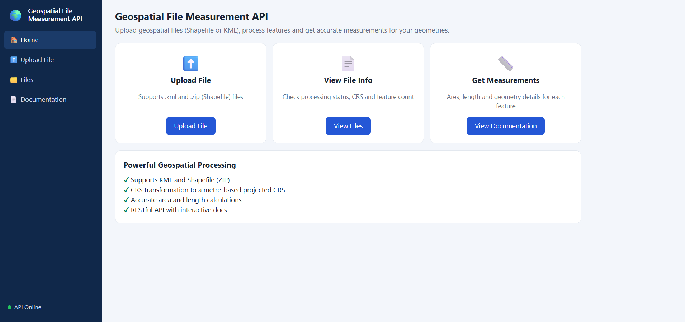
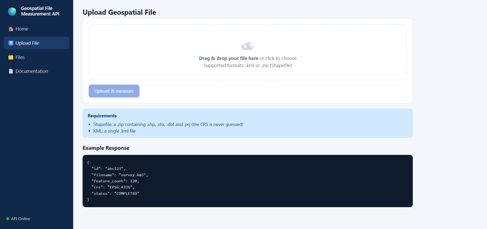
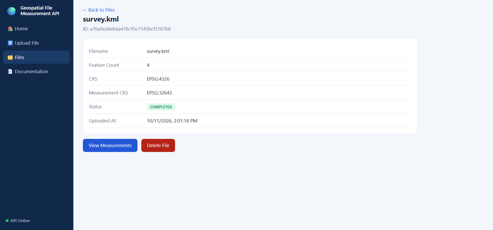
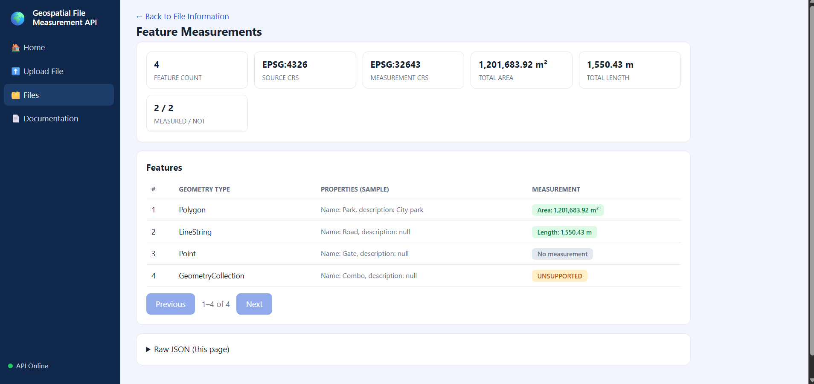
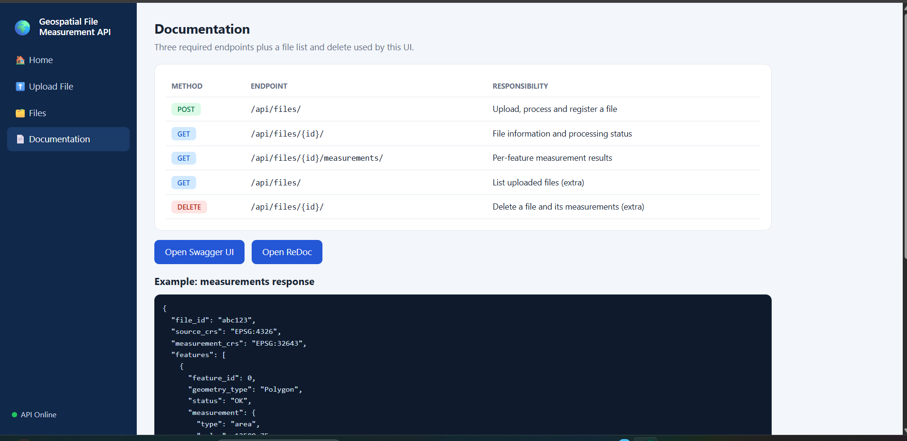
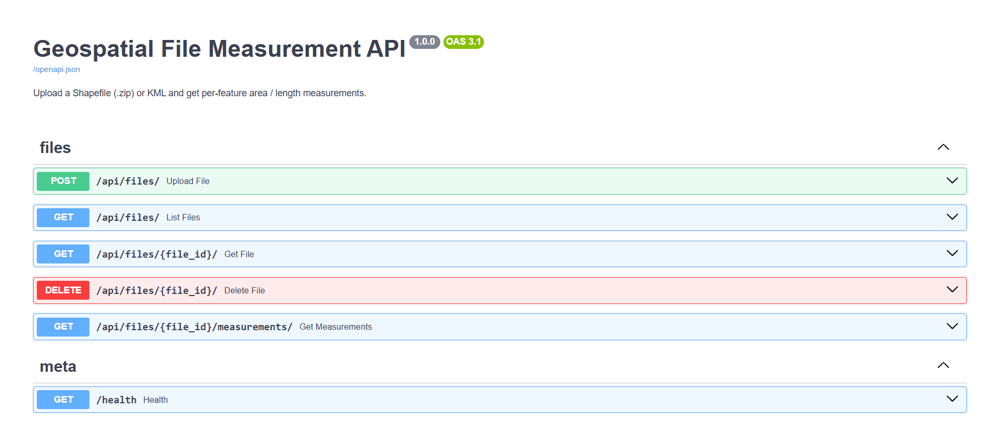
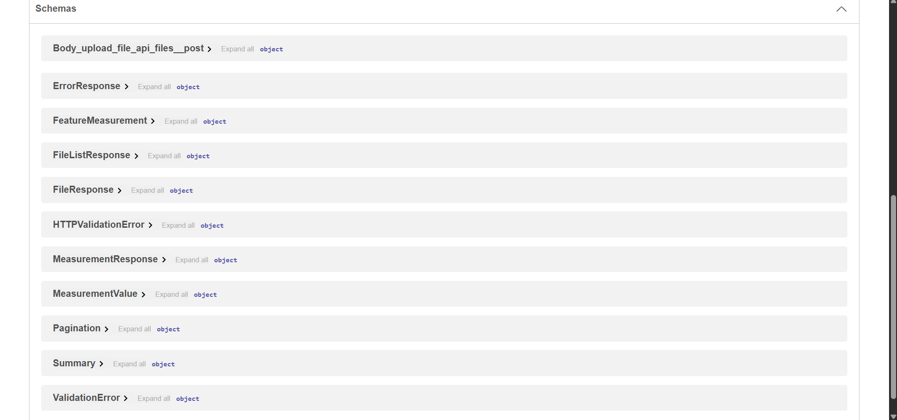
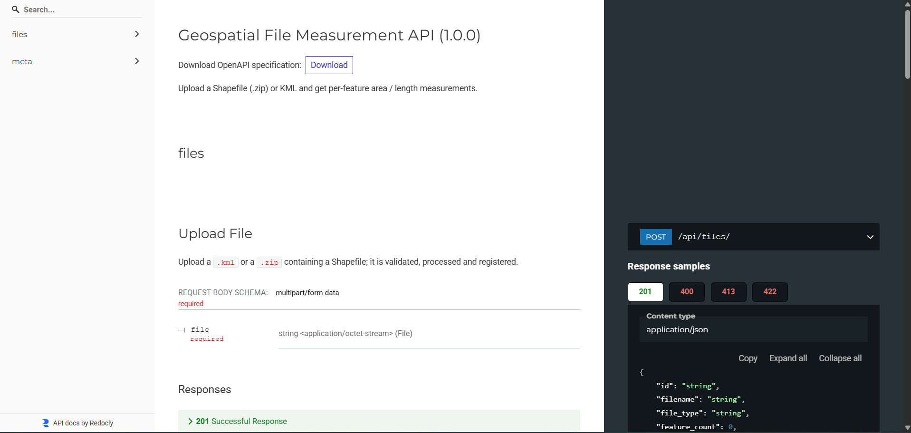
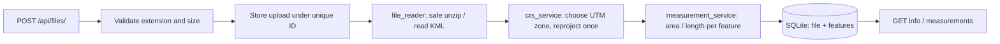

<div align="center">

# 🌍 Geospatial File Measurement API

**Upload a Shapefile or KML. Get accurate area and length for every feature, calculated in metres, not degrees.**

[](https://www.python.org/)
[](https://fastapi.tiangolo.com/)
[](https://geopandas.org/)
[](https://www.sqlalchemy.org/)
[](#11-testing)

[▶ Demo video](ADD_YOUR_VIDEO_LINK_HERE) · [Screenshots](#2-screenshots-and-demo-video) · [API reference](#7-api-reference) · [Quick start](#5-installation)

</div>

---

## Table of contents
1. [Overview and features](#1-overview-and-features)
2. [Screenshots and demo video](#2-screenshots-and-demo-video)
3. [Requirements coverage](#3-requirements-coverage)
4. [Technology stack](#4-technology-stack)
5. [Installation](#5-installation)
6. [Running the application](#6-running-the-application)
7. [API reference](#7-api-reference)
8. [Architecture and processing flow](#8-architecture-and-processing-flow)
9. [CRS selection and measurement units](#9-crs-selection-and-measurement-units)
10. [Error handling and limitations](#10-error-handling-and-limitations)
11. [Testing](#11-testing)
12. [Design decisions and alternatives](#12-design-decisions-and-alternatives-considered)
13. [Learning outcomes and future scope](#13-learning-outcomes-and-future-scope)

---

## 1. Overview and features

A FastAPI backend that accepts a **Shapefile (`.zip`)** or **KML** file, extracts every feature
(ID, geometry type, geometry, CRS, attributes) and returns **area** for polygons and **length** for lines.

The central technical challenge is **coordinate reference systems**. Latitude and longitude are angles, not
distances, so this service reprojects geographic data to a metre-based UTM zone *before* measuring, and
verifies the results against an independent geodesic calculation.

| Capability | Details |
|---|---|
| **Input formats** | `.kml`, or `.zip` containing a Shapefile (`.shp`, `.shx`, `.dbf`, `.prj`) |
| **Measurements** | Polygon / MultiPolygon → area (m²) · LineString / MultiLineString → length (m) · Point → none |
| **CRS handling** | Geographic data (e.g. EPSG:4326) is reprojected to a UTM zone; a missing CRS is rejected, never guessed |
| **Fault tolerance** | One bad feature never fails the file; each feature carries its own `status` and `message` |
| **Persistence** | SQLite via SQLAlchemy (swap with `DATABASE_URL`); file IDs survive restarts |
| **Security** | Upload size cap, zip-slip and zip-bomb protection, sanitised file names, no tracebacks in responses |
| **Interfaces** | REST API, Swagger UI, ReDoc and a web UI (upload, browse, measure, delete) |

## 2. Screenshots and demo video

### Demo video
[](ADD_YOUR_VIDEO_LINK_HERE)

*Click the image to watch the walkthrough: upload → processing → measurements → delete, plus Swagger UI.*

### Screenshots

| | |
|---|---|
| **Home** <br>  | **Upload** <br>  |
| **File information** <br>  | **Feature measurements** <br>  |
| **In-app documentation** <br>  | **Swagger UI** <br>  |
| **API schemas** <br>  | **ReDoc** <br>  |

## 3. Requirements coverage

How each requirement of the assignment is met, and which test proves it.

| Requirement | Implementation | Verified by |
|---|---|---|
| Django or FastAPI backend | FastAPI (`app/main.py`, `app/api/routes.py`) | all API tests |
| `POST /api/files/` accepts `.zip` Shapefile and `.kml` | `upload_file` + `file_reader.py` | `test_upload_kml`, `test_upload_shapefile_zip` |
| Extract ID, geometry type, geometry, CRS, properties | `file_processor.py`, `file_reader.feature_records` | `test_measurements_endpoint_format` |
| Unsupported geometry handled gracefully | `measurement_service.py` returns a status, never raises | `test_unsupported_geometry_is_explained_not_raised`, `test_kml_measurements_with_mixed_geometries` |
| Polygon → area, LineString → length, Point → none | `measurement_service.measure_geometry` | `test_polygon_area_in_square_metres`, `test_linestring_length_in_metres`, `test_point_has_no_measurement` |
| Never measure in degrees; use a projected CRS | `crs_service.py` (UTM zone selection, reproject once) | `test_transformation_matches_geodesic_reference` |
| Missing / invalid CRS handled explicitly | `CRS_MISSING` error, never guessed | `test_missing_crs_is_flagged_not_guessed` |
| `GET /api/files/{id}/` | `get_file` | `test_get_file_information` |
| `GET /api/files/{id}/measurements/` | `get_measurements` (paginated) | `test_measurements_endpoint_format`, `test_pagination_and_geometry_toggle` |
| Unknown ID → 404, unsupported extension → 400, corrupt file → controlled error | `HTTPException` + `FileValidationError` | `test_unknown_file_id_404`, `test_unsupported_extension_400`, `test_corrupt_zip_is_controlled_error` |
| File IDs survive restarts | SQLite persistence (`repositories/`) | `test_data_survives_application_restart` |
| Zip safety and upload size limit | path-traversal check, size caps | `test_zip_slip_rejected`, `test_upload_size_limit` |
| README: setup, API, architecture, decisions, learning, future scope | this document | n/a |
| Public GitHub repository | submitted separately | n/a |

## 4. Technology stack

| Layer | Technology |
|---|---|
| API framework | FastAPI + Uvicorn |
| Geospatial reading | GeoPandas + pyogrio (GDAL) |
| Geometry and CRS | Shapely, PyProj |
| Persistence | SQLAlchemy 2 + SQLite |
| Testing | Pytest + HTTPX |
| UI | Vanilla JavaScript, no build step |

## 5. Installation

**Prerequisites:** Python 3.10 or newer (tested on 3.12 and 3.13). The geospatial wheels bundle GDAL and PROJ,
so no system libraries are required.

```bash
git clone ADD_YOUR_GITHUB_REPO_LINK_HERE
cd geospatial-file-measurement-api

python -m venv .venv
.venv\Scripts\activate            # Windows
# source .venv/bin/activate       # macOS / Linux

pip install -r requirements-dev.txt
```

## 6. Running the application

```bash
uvicorn app.main:app --reload
```

| URL | Purpose |
|---|---|
| http://127.0.0.1:8000/ | Web UI |
| http://127.0.0.1:8000/docs | Swagger UI |
| http://127.0.0.1:8000/redoc | ReDoc |
| http://127.0.0.1:8000/health | Health check |

### Try it in two minutes
1. Start the server as above and open http://127.0.0.1:8000/.
2. Go to **Upload File** and choose `samples/survey.kml`.
3. Open **View Measurements**: the polygon is about **1.2 km²** and the road about **1.55 km**, measured in EPSG:32643.

More samples in `samples/`: `parcels_wgs84.zip`, `roads_wgs84.zip`, `plots_utm43n.zip` (regenerate with `python samples/make_samples.py`).

### Configuration
All variables are optional.

| Variable | Default | Meaning |
|---|---|---|
| `DATA_DIR` | `./data` | SQLite database and stored uploads |
| `DATABASE_URL` | `sqlite:///data/app.db` | Any SQLAlchemy URL (for example PostgreSQL) |
| `MAX_UPLOAD_MB` | `50` | Maximum upload size |
| `MAX_UNZIPPED_MB` | `200` | Maximum uncompressed size of a zip |

### Troubleshooting
| Problem | Fix |
|---|---|
| `No module named ...` | The virtual environment is not active; run the activate command again |
| `Address already in use` | Use `uvicorn app.main:app --reload --port 8001` |
| PowerShell blocks activation | Run `Set-ExecutionPolicy -Scope Process Bypass`, or use Command Prompt |
| UI looks outdated after an update | Hard-refresh the browser with `Ctrl+F5` |

## 7. API reference

| Method | Endpoint | Responsibility |
|---|---|---|
| `POST` | `/api/files/` | Upload, process and register a file |
| `GET` | `/api/files/{id}/` | File information and processing status |
| `GET` | `/api/files/{id}/measurements/` | Per-feature measurements (`limit`, `offset`, `include_geometry`) |
| `GET` | `/api/files/` | List uploaded files, newest first (used by the UI) |
| `DELETE` | `/api/files/{id}/` | Delete a file, its measurements and the stored original (`204`) |

### Upload
```bash
curl -F "file=@samples/survey.kml" http://127.0.0.1:8000/api/files/
```
```json
{
  "id": "a76a9ce6eb6a478c95c7145bcf3187b8",
  "filename": "survey.kml",
  "file_type": "kml",
  "feature_count": 4,
  "crs": "EPSG:4326",
  "measurement_crs": "EPSG:32643",
  "status": "COMPLETED",
  "warnings": [],
  "error_code": null,
  "error": null,
  "uploaded_at": "2026-10-11T08:31:18.250000Z"
}
```

### File information
```bash
curl http://127.0.0.1:8000/api/files/a76a9ce6eb6a478c95c7145bcf3187b8/
```
Returns the same object as the upload response. `status` is `PROCESSING`, `COMPLETED` or `FAILED`.

### Measurements
```bash
curl "http://127.0.0.1:8000/api/files/a76a9ce6eb6a478c95c7145bcf3187b8/measurements/?include_geometry=false"
```
```json
{
  "file_id": "a76a9ce6eb6a478c95c7145bcf3187b8",
  "source_crs": "EPSG:4326",
  "measurement_crs": "EPSG:32643",
  "warnings": [],
  "summary": {"total_area_sq_m": 1201683.9191, "total_length_m": 1550.4271, "measured": 2, "not_measured": 2},
  "pagination": {"limit": 100, "offset": 0, "total": 4},
  "features": [
    {"feature_id": 0, "geometry_type": "Polygon", "properties": {"Name": "Park", "description": "City park"},
     "status": "OK", "message": null, "measurement": {"type": "area", "value": 1201683.9191, "unit": "m²"}},
    {"feature_id": 1, "geometry_type": "LineString", "properties": {"Name": "Road"},
     "status": "OK", "message": null, "measurement": {"type": "length", "value": 1550.4271, "unit": "m"}},
    {"feature_id": 2, "geometry_type": "Point", "properties": {"Name": "Gate"},
     "status": "NOT_APPLICABLE", "message": "Points have no area or length", "measurement": null},
    {"feature_id": 3, "geometry_type": "GeometryCollection", "properties": {"Name": "Combo"},
     "status": "UNSUPPORTED", "message": "Measurement is not supported for GeometryCollection", "measurement": null}
  ]
}
```

**Feature `status` values:** `OK` · `NOT_APPLICABLE` (points) · `UNSUPPORTED` · `EMPTY_GEOMETRY` · `INVALID_GEOMETRY` · `FAILED`

### Delete
```bash
curl -X DELETE http://127.0.0.1:8000/api/files/a76a9ce6eb6a478c95c7145bcf3187b8/
```
Returns `204 No Content`. The record, all its measurements and the stored original file are removed.

### Errors
Always JSON, never a traceback.

| HTTP | When |
|---|---|
| `400` | Unsupported file extension |
| `404` | Unknown file ID (also for `DELETE`) |
| `409` | Measurements requested for a file that is not `COMPLETED` |
| `413` | Upload larger than `MAX_UPLOAD_MB` |
| `422` | Invalid content. Body: `{"detail", "code", "id"}`; the failed record stays queryable |

`422` error codes: `INVALID_ARCHIVE`, `ARCHIVE_TOO_LARGE`, `MISSING_SHAPEFILE_COMPONENTS`, `MULTIPLE_SHAPEFILES`, `CRS_MISSING`, `UNREADABLE_FILE`, `PROCESSING_ERROR`.

```json
{"detail": "Shapefile is missing required component(s): .shx", "code": "MISSING_SHAPEFILE_COMPONENTS", "id": "…"}
```

## 8. Architecture and processing flow



```
app/
├── main.py                        application setup, serves the UI
├── api/routes.py                  HTTP endpoints only
├── services/
│   ├── file_reader.py             validate and read KML / zipped Shapefile
│   ├── crs_service.py             choose measurement CRS, reproject
│   ├── measurement_service.py     area / length per geometry (never raises)
│   └── file_processor.py          orchestration: read → CRS → measure → persist
├── schemas/file_schema.py         Pydantic response models
├── repositories/                  SQLAlchemy models + FileRepository (all DB access)
├── core/                          configuration, database setup
└── static/index.html              web UI
tests/        samples/        docs/screenshots/
```

Each module has a single responsibility: routes never touch the database or GDAL directly, and services know nothing about HTTP.

**File-processing flow:** the upload is streamed to disk under a unique ID (size-capped) → `FileRepository.create` registers it →
`file_reader` validates the archive and reads the data → `crs_service` picks the measurement CRS and reprojects all geometries once →
`measurement_service` measures each feature independently → results are saved in one transaction and the file becomes `COMPLETED`
(or `FAILED` with a code and message).

**Measurement flow:** for each feature: empty/null → `EMPTY_GEOMETRY` · point → `NOT_APPLICABLE` · other non-polygon/line types → `UNSUPPORTED` ·
invalid → `INVALID_GEOMETRY` · otherwise `.area` (m²) or `.length` (m) from the projected geometry.

## 9. CRS selection and measurement units

1. **Missing CRS → `CRS_MISSING` error.** A Shapefile without `.prj` is never silently assumed to be EPSG:4326.
2. **Source already projected in metres → measured as is.**
3. **Otherwise** (EPSG:4326, other geographic CRSs, projected CRSs in feet) → the **UTM zone containing the centre of the dataset's extent**
   (EPSG:326xx north / 327xx south). Beyond 84°N / 80°S, polar stereographic (EPSG:3413 / 3031). Bengaluru resolves to EPSG:32643.
4. Geometries are reprojected once, Z values are dropped, then `.area` (m²) and `.length` (m) are read.

The chosen CRS is returned as `measurement_crs`. A test confirms the rule agrees with GeoPandas `estimate_utm_crs()`, and results are
verified against an independent geodesic calculation (`pyproj.Geod`) within 0.2 %.

## 10. Error handling and limitations

- One bad feature never stops the file; every feature carries its own `status` and `message`.
- **Invalid geometry policy:** invalid geometries (for example self-intersecting polygons) are reported as `INVALID_GEOMETRY` with the
  reason and are **not measured**. Data is never silently "repaired".
- **Archive safety:** path-traversal check, uncompressed-size cap, exactly one `.shp` with its `.shx` and `.dbf`.
- **Limitations**
  - One UTM zone per dataset. A warning is returned when the extent spans several zones, because accuracy drops far from the zone.
  - Not suitable for legal or engineering-grade surveying.
  - Antimeridian-crossing data is not handled.
  - Processing is synchronous (appropriate for files up to the configured limit).

## 11. Testing

```bash
pytest -q        # 53 tests
```

| File | Covers |
|---|---|
| `tests/test_crs.py` | UTM zone selection, metric and non-metric sources, missing CRS, transformation vs geodesic reference, round trip, multi-zone warning |
| `tests/test_measurements.py` | Polygon, line, multi-geometries, point, unsupported, empty, invalid, mixed files, response format, pagination |
| `tests/test_upload.py` | KML and Shapefile upload, extension / corrupt / missing-component / missing-CRS / zip-slip / size errors, unknown ID, file info, list, delete, **persistence after restart** |

Tests use an isolated temporary database and data directory, so they never touch real data.

## 12. Design decisions and alternatives considered

| Decision | Why | Alternative |
|---|---|---|
| FastAPI | Typed models, automatic OpenAPI docs, small surface | Django REST Framework (heavier; better when auth or admin are needed) |
| Layered structure (routes → services → repository) | Single responsibility; each layer testable alone | Logic inside route handlers |
| SQLite + SQLAlchemy | Persistent with zero setup; `DATABASE_URL` swaps to PostgreSQL | In-memory dict (lost on restart), PostGIS |
| Synchronous processing | Files are bounded; simplest correct design; immediate final status | Celery/RQ background jobs (the `status` field already models this) |
| Measure once at upload, store results | GET endpoints are cheap, paginated reads | Compute on demand |
| One UTM zone per dataset, reported as `measurement_crs` | Accurate for local datasets and easy to explain | Per-feature zone; geodesic area; equal-area CRS for global data |
| GeoPandas + pyogrio | One reader for Shapefile and KML; wheels bundle GDAL | fiona (needs system GDAL); pyshp + fastkml (two code paths) |
| Reject missing CRS | A wrong assumption silently produces wrong areas | Default to EPSG:4326 with a warning |
| Persist failed uploads as `FAILED` | Clients can look up what went wrong later | Discard them |
| Invalid geometries reported, not repaired | No silent data modification | `make_valid` before measuring |

## 13. Learning outcomes and future scope

**Learning**
- Degrees are not metres: a 0.01° square near Bengaluru is about 1.2 km², yet its raw `.area` is 0.0001.
- How UTM zones follow longitude, why polar regions need another projection, and the limits of one zone per dataset.
- KML specifics: each Folder is a GDAL layer, `MultiGeometry` becomes a GeometryCollection, altitude must be ignored.
- Testing against an independent oracle (geodesic area) instead of hard-coded numbers.
- Handling untrusted archives (zip-slip, decompression bombs) and keeping errors controlled.

**Future scope**
- Background processing (Celery/RQ) with progress reporting; cloud storage for uploads.
- PostGIS storage with spatial queries (bbox, intersects) and GeoJSON export.
- Geodesic measurement option and per-feature / multi-zone handling.
- Optional `default_crs` upload field when `.prj` is missing; GeoJSON and GeoPackage support.
- Perimeter, centroid, bounding box; selectable area units (ha, acres, km²).
- Authentication and per-user files; retention policy for uploads.
- Docker image, Alembic migrations, GitHub Actions CI running `pytest`.

---

<div align="center">

**Author:** Manish U

</div>